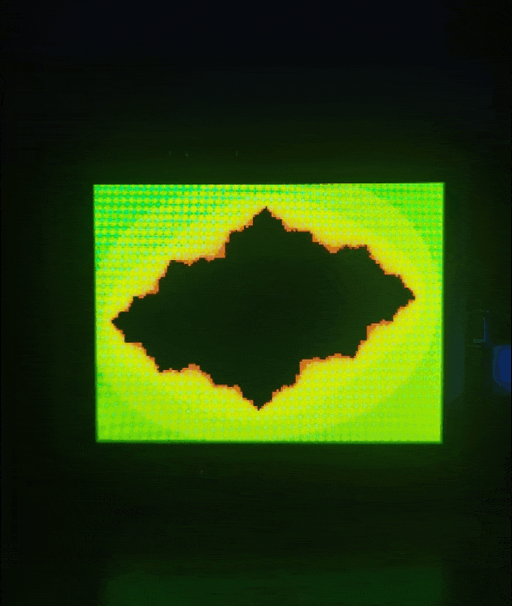

# Arduino Uno Julia Fractal — AVR Optimized


An animated, real-time Julia set fractal renderer for the Arduino Uno (ATmega328P @ 16 MHz), designed to fit within its very limited 2 KB SRAM budget.

The project focuses on practical embedded optimization: replacing floating-point math in the rendering loop with fixed-point integer arithmetic, lookup tables, and block-based TFT transfers.

## Showcase





## Features

- Real-time animated Julia set rendering on an Arduino Uno.
- Smoothly evolving fractal shape and animated color palette.
- Fixed-point Q8.8 arithmetic in the render loop; no `float`, `sin()`, or `cos()` per frame.
- Precomputed 64-point trajectory table with interpolation for smooth shape motion.
- Compact 64-color base palette expanded to 256 smooth color phases.
- Block-based TFT rendering using `setAddrWindow()` and `pushColors()`.
- Three rendering scales: 2x, 4x, and 6x pixel blocks.
- The selected scale is stored in EEPROM and restored after a reset or power cycle.

## Hardware

- Arduino Uno or compatible ATmega328P board.
- MCUFRIEND-compatible 2.4" TFT LCD shield using an 8-bit parallel interface.
- Common supported controllers include ILI9341 and ILI9486.
- The sketch prints the detected display ID to the Serial Monitor.

## How It Works

The AVR has no hardware floating-point unit, so floating-point operations are emulated in software and are expensive. This project keeps the hot rendering loop entirely in integer arithmetic.

### Fixed-point Julia set
Coordinates are represented in Q8.8 fixed-point format: one unit equals 256. The Julia iteration uses 32-bit intermediate multiplications, then narrows the results back to 16-bit values after shifting.

### Animated shape
The fractal parameter `c` follows a precomputed 64-point trajectory. The sketch interpolates between neighboring points, producing smooth motion without calling `sin()` or `cos()` during rendering.

### Animated palette
A compact 64-color base palette is expanded into smooth 256-phase color cycles. Only the 12 colors required by the current iteration count are calculated once per frame.

### Display rendering
Instead of drawing individual pixels, the renderer fills a line buffer and sends a vertical block of `scale` rows through one address-window command. This reduces display command overhead substantially.

## Memory Budget

| Buffer | Size |
|---|---:|
| `lineBuffer[320]` | 640 B |
| `trajRe[64] + trajIm[64]` | 256 B |
| `fullPalette[64]` | 128 B |
| `palFrame[12]` | 24 B |
| **Global arrays total** | **~1.05 KB** |

The remaining SRAM is available for the stack, Arduino core, and TFT library.

## Build and Flash

Developed with PlatformIO; compatible with Arduino IDE 2.x.

1. Install the Arduino IDE or PlatformIO.
2. Install the following libraries:
   - [`Adafruit GFX Library`](https://github.com/adafruit/Adafruit-GFX-Library)
   - [`MCUFRIEND_kbv`](https://github.com/prenticedavid/MCUFRIEND_kbv) by David Prentice
3. Clone this repository.
4. Open the sketch in the Arduino IDE, or the PlatformIO project.
5. Select **Arduino Uno** and the correct serial port.
6. Upload the sketch.
7. Open the Serial Monitor at `115200 baud` to see the detected TFT controller ID.

Example Serial Monitor output:

```text
Scale = 2
TFT ID: 0x2053
```

## Usage

Power on the board and the animation starts automatically.

Press the reset button on the Arduino board or TFT shield to cycle between rendering scales:

- `2x` — higher visual detail
- `4x` — balanced quality and speed
- `6x` — fastest rendering

The selected scale is stored in EEPROM and restored after a reset or power cycle.

## Performance

Performance depends on the TFT controller, Arduino clone, and selected scale. The project is optimized for smooth animation on stock Arduino Uno hardware.

<!-- Add measured FPS results here after benchmarking. -->

## Compatibility & Known Issues

- Tested on: 2.4" TFT LCD Shield (MCUFRIEND 8-bit parallel interface) with ILI9342 controller (detected ID: 0x2053)
- Some Arduino Uno clones require a stable external 5V power supply, as the TFT backlight can draw significant current.
- If the display remains white, check the Serial Monitor for the detected TFT ID and ensure it matches your controller.

## Ideas for Improvement

- Add alternative color palettes.
- Add adjustable animation speed.
- Explore a Mandelbrot mode with vertical symmetry optimization.
- Port the renderer to ESP32 or RP2040 for higher resolution and frame rates.
- Add a serial command interface for changing scale, palette, and animation speed.

## 🌐 Language / Язык

- **English:** Source code comments are in English in `src/main.cpp`.
- **Русский:** Версия кода с русскими комментариями доступна в [`docs/main_ru.cpp`](docs/main_ru.cpp).

> This does not affect compilation — `docs/` is excluded from the build.

## License

Released under the [MIT License](LICENSE).